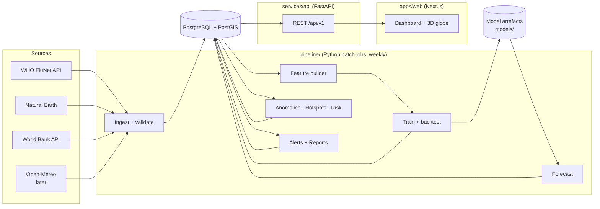
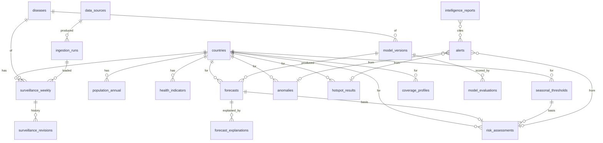
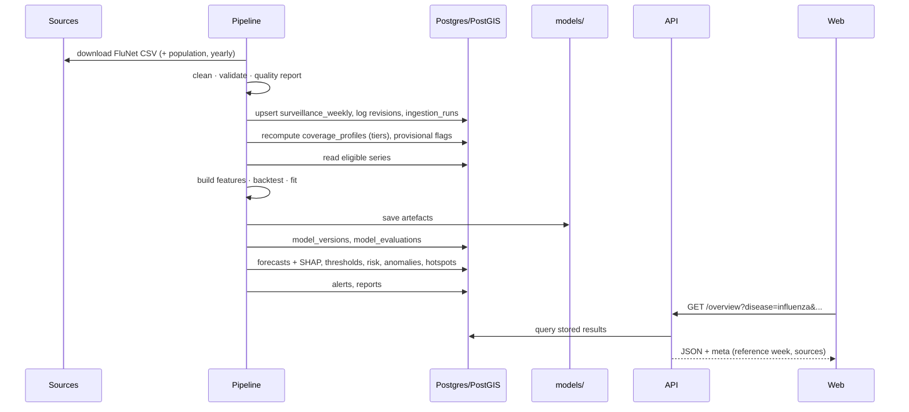

# Epidemic Intelligence — Design Package

**Status:** draft for approval · 2026-11-09
Builds on [PROJECT_SPEC.md](PROJECT_SPEC.md) (scope) and [datasets/](datasets/README.md)
(verified data). Nothing here is implemented yet except the FluNet profiler.

Contents
1. [Architecture](#1-architecture)
2. [First disease and datasets](#2-first-disease-and-datasets)
3. [Database schema](#3-database-schema)
4. [Frontend page hierarchy](#4-frontend-page-hierarchy)
5. [API](#5-api)
6. [ML pipeline](#6-ml-pipeline)
7. [Data flow](#7-data-flow)
8. [Folder structure](#8-folder-structure)
9. [Milestones](#9-milestones)
10. [Risks and open decisions](#10-risks-and-open-decisions)

---

## 1. Architecture

Three runtime parts and one database. The API is **read-mostly**: all heavy work
(ingestion, training, forecasting, detection) runs in the pipeline as scheduled batch
jobs and writes results to the database. The API serves those stored results.



| Part | Responsibility | Tech |
|---|---|---|
| `apps/web` | UI, globe, charts, filters. No business logic beyond presentation. | Next.js (App Router), TypeScript, Tailwind, shadcn/ui, ECharts, MapLibre GL + deck.gl, TanStack Query |
| `services/api` | Validated, paginated, cached read endpoints; report generation trigger. | FastAPI, Pydantic v2, SQLAlchemy 2, GeoAlchemy2 |
| `pipeline` | Ingestion, quality checks, features, training, backtesting, forecasting, detection, alerts, reports. CLI entry points. | pandas, scikit-learn, XGBoost, SHAP, PySAL (esda/libpysal), GeoPandas |
| `packages/ei_db` | Shared SQLAlchemy models + Alembic migrations, used by both API and pipeline. | SQLAlchemy, Alembic |
| Database | Single source of truth for data and results. | PostgreSQL 16 + PostGIS 3 |

Why batch, not on-request ML: forecasts change weekly with the data; precomputing keeps
the API fast, makes every displayed number traceable to a stored model run, and avoids
running training inside a web server.

**Scheduling:** one weekly job (`ei run-weekly`) chains all pipeline steps. Locally run
by hand; in deployment via GitHub Actions cron.

---

## 2. First disease and datasets

**Influenza via WHO FluNet** — confirmed by profiling ([flunet_profile.md](datasets/flunet_profile.md)):
weekly, 189 countries/areas, 1995–2026; **88 countries forecast-ready (Tier A)**,
44 usable with caution (Tier B), spread across all six WHO regions.

| Dataset | Used for | Milestone | Status |
|---|---|---|---|
| WHO FluNet | Positives, specimens, positivity | M2 | Verified |
| Natural Earth 1:50m Admin-0 | Globe polygons, centroids, spatial weights | M1–M2 | To verify (public domain) |
| World Bank WDI `SP.POP.TOTL` | Population, per-capita normalisation | M2 | To verify |
| World Bank / WHO GHO: hospital beds, physicians per 1,000 | Country health-system context | M4 | To verify |
| Open-Meteo | Weather features (dengue phase) | Post-MVP | Partly verified |
| OpenDengue | Dengue | Post-MVP | Licence open |

Key data facts that shape the design:
- FluNet values are **lab results, not cases** → UI says "lab-confirmed detections" and
  "test positivity", never "cases", for influenza.
- Last ~3 weeks are **provisional** → stored with `is_provisional`, shown hatched/greyed,
  excluded from training and anomaly detection.
- **2020-03 → 2022-06** (COVID-19 disruption) → excluded from training targets and
  seasonal baselines by default, kept for display.

---

## 3. Database schema

Conventions: `iso3 CHAR(3)` country key; `week_start DATE` (ISO Monday) as time key with
`iso_year`/`iso_week` alongside; SRID 4326; `created_at`/`updated_at` on mutable tables;
every data row references its `source_id` and `ingestion_run_id`.

### ER diagram



### Tables

**Reference**

| Table | Key columns |
|---|---|
| `countries` | `iso3` PK, `iso2`, `name`, `who_region`, `hemisphere`, `transmission_zone`, `continent`, `geom MULTIPOLYGON`, `centroid POINT` · GiST index on `geom` |
| `country_code_aliases` | `alias` PK, `iso3` FK, `source_id` — maps source codes (e.g. `XKX`, `X09`) |
| `diseases` | `id` PK, `key` (`influenza`), `name`, `native_granularity`, `primary_metric`, `metric_label`, `supports_forecast`, `supports_anomaly`, `supports_hotspots` |
| `data_sources` | `id` PK, `key`, `name`, `url`, `licence`, `attribution_text`, `notes` |
| `ingestion_runs` | `id` PK, `source_id` FK, `started_at`, `finished_at`, `status`, `raw_rows`, `loaded_rows`, `raw_sha256`, `quality_report JSONB` |

**Observations**

| Table | Key columns |
|---|---|
| `surveillance_weekly` | `id` PK, `disease_id` FK, `iso3` FK, `week_start`, `iso_year`, `iso_week`, `specimens_tested`, `positives`, `cases` (NULL for influenza), `positivity`, `breakdown JSONB` (subtypes), `is_provisional`, `source_id`, `ingestion_run_id`, `updated_at` · UNIQUE(`disease_id`,`iso3`,`week_start`) · index (`disease_id`,`week_start`) |
| `surveillance_revisions` | `id` PK, `surveillance_id` FK, `previous_values JSONB`, `revised_at`, `ingestion_run_id` — append-only history when a source revises a past week |
| `population_annual` | (`iso3`,`year`) PK, `population`, `source_id` |
| `health_indicators` | (`iso3`,`indicator_code`,`year`) PK, `value`, `unit`, `source_id` |
| `weather_weekly` (post-MVP) | (`iso3`,`week_start`) PK, `temp_mean`, `precip_sum`, `rh_mean`, `n_points`, `source_id` |
| `coverage_profiles` | (`disease_id`,`iso3`,`reference_week`) PK, `tier`, `completeness`, `longest_gap`, `median_tests`, `weeks_since_last` — output of the profiler, drives which countries get forecasts |

**Models and outputs**

| Table | Key columns |
|---|---|
| `model_versions` | `id` PK, `disease_id`, `model_type` (`seasonal_naive`,`rf`,`xgboost`,…), `target` (`positivity`,`positives`), `version`, `train_start`, `train_end`, `features JSONB`, `hyperparams JSONB`, `artefact_uri`, `git_sha`, `trained_at`, `is_active` |
| `model_evaluations` | `id` PK, `model_version_id` FK, `horizon_weeks`, `iso3` (NULL = pooled), `metric` (`mae`,`rmse`,`mase`,`skill_vs_snaive`,`coverage_80`,`coverage_95`), `value`, `n_origins`, `eval_start`, `eval_end` |
| `forecasts` | `id` PK, `model_version_id` FK, `disease_id`, `iso3`, `origin_week`, `target_week`, `horizon_weeks`, `target`, `point`, `lo80`, `hi80`, `lo95`, `hi95`, `created_at` · UNIQUE(`model_version_id`,`iso3`,`origin_week`,`horizon_weeks`,`target`) |
| `forecast_explanations` | (`forecast_id`,`feature`) PK, `shap_value`, `feature_value` — top-k contributors |
| `seasonal_thresholds` | `id` PK, `disease_id`, `iso3`, `season`, `method`, `epidemic_threshold`, `medium`, `high`, `very_high`, `n_seasons_used` |
| `risk_assessments` | `id` PK, `disease_id`, `iso3`, `assessed_week`, `target_week`, `risk_level` (`low`,`moderate`,`high`), `rule`, `forecast_id` FK, `threshold_id` FK |
| `anomalies` | `id` PK, `disease_id`, `iso3`, `week_start`, `metric`, `observed`, `expected`, `upper_band`, `score`, `method`, `severity`, `detected_at` |
| `hotspot_results` | `id` PK, `disease_id`, `iso3`, `window_end`, `window_weeks`, `statistic` (`gi_star`,`local_moran`), `z_score`, `p_value`, `p_fdr`, `classification`, `weights_spec` |
| `alerts` | `id` PK, `disease_id`, `iso3`, `alert_type`, `severity`, `week_start`, `title`, `details JSONB`, `anomaly_id`/`hotspot_id`/`risk_id` FKs (nullable), `created_at` |
| `intelligence_reports` | `id` PK, `disease_id`, `iso3` (nullable = global), `period_start`, `period_end`, `content JSONB` (structured facts), `rendered_md`, `generator` (`template`/`llm`), `inputs_sha256`, `created_at` |
| `report_alerts` | (`report_id`,`alert_id`) PK |

Migrations: Alembic in `packages/ei_db/migrations/`, one revision per milestone.

---

## 4. Frontend page hierarchy

```
/                         Overview
/surveillance             Global Surveillance (full-screen globe)
/countries                Country index (search, sortable table, tiers)
/countries/[iso3]         Country Intelligence
/hotspots                 Hotspots & Anomalies
/predictions              Prediction Center
/predictions/models/[id]  Model detail (backtest, SHAP global importance)
/analytics                Analytics
/reports                  Reports & Alerts (tabs: Alerts | Reports)
/reports/[id]             Report detail
/about                    About the Data (sources, licences, limitations, model cards)
```

**Shell (every page):** left sidebar (collapsible), top bar with search (countries,
diseases), disease selector, date range, WHO-region filter, data-status pill
(reference week, provisional weeks, last refresh). Filters live in the URL query
string so every view is shareable and back-button safe.

| Page | Main components |
|---|---|
| Overview | KPI strip (5 KPIs from spec §4) · globe (positivity choropleth) · global positivity trend with provisional shading · top movers table · latest alerts |
| Global Surveillance | Globe full-bleed · layer panel (positivity, detections columns, anomalies, hotspots, forecast change, risk) · time slider · legend · country side panel on click |
| Country Intelligence | Header (name, region, tier, data badges) · history chart (positivity + tests, provisional shading) · seasonal profile (this season vs. past seasons + thresholds) · forecast chart with 80/95% bands · anomalies timeline · hotspot status · population & health-system context ("Not available" where missing) |
| Hotspots & Anomalies | Globe/flat map of Gi\* classes · hotspot table (z, p_fdr) · anomaly feed · historical comparison |
| Prediction Center | Country + horizon + model selectors · forecast chart · backtest metrics table vs. seasonal-naive · interval coverage · per-forecast SHAP waterfall |
| Analytics | Multi-country comparison · weekly/monthly/yearly aggregation · seasonal heatmap (week × year) · growth rates · subtype mix (A/B) |
| Reports & Alerts | Alert list with filters · report list · generate report (country/global) |
| About | Source cards with licence + attribution · coverage tiers · known limitations · model cards |

Globe rendering plan: MapLibre GL v5 globe projection, Natural Earth polygons as a
GeoJSON source (no third-party basemap needed for the dark "command centre" look),
deck.gl for 3D columns/arcs. **M1 includes a spike** to confirm MapLibre-globe + deck.gl
interop; fallback is MapLibre-native `fill-extrusion` layers.

---

## 5. API

All under `/api/v1`, JSON, OpenAPI docs at `/docs`. Common query params: `disease`,
`from`, `to`, `region`, `iso3`, `page`, `page_size`. Responses include a `meta` block with
`reference_week`, `provisional_from`, `sources`, and `demo: false`.

| Endpoint | Serves |
|---|---|
| `GET /meta/status` | Reference week, provisional weeks, last ingestion/training runs |
| `GET /diseases` | Diseases + capability flags |
| `GET /countries` | Country list with tier, latest positivity (paginated) |
| `GET /countries/{iso3}` | Profile: metadata, population, health indicators, tier |
| `GET /countries/{iso3}/timeseries` | Weekly series (+ provisional flags) |
| `GET /countries/{iso3}/seasons` | Season-aligned curves + thresholds |
| `GET /overview` | KPIs, global trend, top movers |
| `GET /surveillance/global` | Per-country values for one week/window (map layers) |
| `GET /geo/countries` | Simplified country geometries (GeoJSON, cached) |
| `GET /analytics/trends` | Aggregated comparisons |
| `GET /forecasts` | Stored forecasts (by country, horizon, model) |
| `GET /forecasts/{id}/explanation` | SHAP contributors |
| `GET /models` · `GET /models/{id}` | Model registry + evaluations |
| `GET /anomalies` · `GET /hotspots` · `GET /risk` | Detection outputs |
| `GET /alerts` · `GET /reports` · `GET /reports/{id}` | Alerts and reports |
| `POST /reports/generate` | Build a template report from stored data |

No auth in MVP: everything is read-only public data except `POST /reports/generate`,
which only reads stored results (rate-limited).

---

## 6. ML pipeline

### 6.1 Data preparation
1. Load cleaned weekly series for countries in Tier A and B.
2. Reindex to a complete weekly calendar; mark missing weeks (not zero-filled).
3. Mask: provisional weeks, COVID disruption window, weeks with < 10 tests (positivity
   too noisy).

### 6.2 Forecasting
- **Primary target (MVP):** weekly **positivity** per country (modelled on logit scale).
  Second target, added once positivity is done: `log1p(positives)`.
- **Horizons:** 1, 2, 4 weeks; **direct** strategy (one model per horizon).
- **Model scope:** one **pooled global model** per horizon across all eligible countries
  (much more training data than per-country models), with country descriptors as
  features. Baselines are per country.
- **Features** (all computed from data available at the forecast origin):

| Group | Features |
|---|---|
| Autoregressive | positivity lags 1–4, rolling mean/std 4 and 8 weeks, change over 1/2/4 weeks |
| Seasonal memory | positivity at same ISO week last year (±1 week mean), last season's peak |
| Calendar | ISO week sin/cos, weeks since hemisphere season start |
| Testing | log specimens tested lag 1, testing trend |
| Spatial | lagged mean positivity of neighbours (same spatial weights as hotspots) and of transmission zone |
| Static | hemisphere, transmission zone, latitude of centroid |

- **Models:** seasonal-naive, last-value, 4-week moving average (baselines) → Random
  Forest → XGBoost. LSTM only evaluated post-MVP, adopted only if it beats XGBoost.
- **Backtesting:** rolling origin, expanding window. Origins every 2 weeks from
  2024-10 to the reference week (two full northern and southern seasons). Training
  window at each origin ends at the origin; no future data, no random splits.
- **Metrics:** MAE, RMSE, MASE (scaled by in-sample seasonal-naive), skill vs.
  seasonal-naive, interval coverage at 80% and 95%. Reported pooled and per country.
- **Intervals:** split conformal prediction from backtest residuals, per horizon,
  scaled by recent volatility.
- **Selection:** per horizon, the active model is the best on backtest MASE **and** must
  beat seasonal-naive; otherwise the baseline stays active and the UI says so.
- **Explainability:** SHAP TreeExplainer for RF/XGBoost — global importance per model
  version; top-8 contributors stored per forecast.
- **Registry:** each training run writes a `model_versions` row, `model_evaluations`
  rows, an artefact under `models/<disease>/<target>/<version>/` (model + config +
  feature list), and a model card in `docs/models/`.

### 6.3 Seasonal thresholds and risk
- Per country per season, compute an **epidemic threshold** and **intensity levels**
  (medium/high/very high) from previous non-COVID seasons, following the Moving
  Epidemic Method approach used in WHO's PISA guidance. Implemented in Python and
  checked against the reference R `mem` package on a few countries.
- Countries with < 3 usable past seasons get no thresholds → risk "Not assessed".
- **Risk rule** (shown in UI): forecast at horizon 2 below epidemic threshold = Low;
  between epidemic threshold and high intensity = Moderate; at or above high intensity =
  High. The interval is shown alongside the level.

### 6.4 Anomaly detection
- Expected value = seasonal baseline (median and 90th percentile of the same ISO week
  ±1 over the last 5 usable seasons).
- Flag when observed positivity exceeds the upper band **and** an EWMA control chart on
  the residual signals; severity from the standardised residual.
- Isolation Forest (positivity, tests, growth) as a secondary signal, reported
  separately, never alone as an alert trigger.

### 6.5 Hotspot detection
- Input: 4-week mean positivity per country ending at the reference week.
- Spatial weights: queen contiguity from Natural Earth polygons, plus k-nearest
  neighbours (k=4) for islands/countries without land neighbours; row-standardised.
- Statistics: Getis-Ord Gi\* (hot/cold spots) and Local Moran's I (cluster/outlier
  type), 999 permutations, Benjamini–Hochberg FDR at 0.05.
- Only countries with data in the window participate; the UI marks the rest as "no
  data", not "cold".

### 6.6 Alerts and reports
Rules generate alerts from stored outputs (new anomaly, new hotspot, risk escalation,
sustained growth > documented rate). Reports are deterministic templates over stored
facts; each report stores its input hash so it can be reproduced.

---

## 7. Data flow

Weekly run (`ei run-weekly`), each step idempotent and recorded:



Retraining cadence: full retrain + backtest monthly; weekly runs reuse the active model
version to produce new forecasts.

---

## 8. Folder structure

```
epidemic-intelligence/
├── apps/
│   └── web/                       Next.js app
│       ├── src/app/               routes (see §4)
│       ├── src/components/
│       │   ├── layout/            sidebar, topbar, filters
│       │   ├── globe/             MapLibre + deck.gl layers
│       │   ├── charts/            ECharts wrappers
│       │   └── ui/                shadcn/ui primitives
│       ├── src/lib/               api client, query hooks, formatters
│       └── src/styles/            design tokens
├── services/
│   └── api/
│       ├── app/
│       │   ├── main.py
│       │   ├── routers/           one module per resource
│       │   ├── schemas/           Pydantic response models
│       │   ├── queries/           SQL/ORM query functions
│       │   └── core/              config, db session, errors, caching
│       └── tests/
├── pipeline/
│   ├── src/ei_pipeline/
│   │   ├── sources/               flunet.py, natural_earth.py, worldbank.py
│   │   ├── ingest/                load to DB, revisions, quality checks
│   │   ├── features/
│   │   ├── models/                baselines, rf, xgb, conformal, registry
│   │   ├── evaluation/            backtesting, metrics
│   │   ├── detection/             anomalies, hotspots, thresholds, risk
│   │   ├── reporting/             alerts, report templates
│   │   └── cli.py                 `ei` command
│   ├── scripts/                   one-off analysis (profile_flunet.py)
│   └── tests/
├── packages/
│   └── ei_db/                     SQLAlchemy models + Alembic migrations
├── models/                        trained artefacts (gitignored)
├── data/
│   ├── raw/                       downloads (gitignored)
│   └── profiles/                  generated profiles
├── docs/
│   ├── PROJECT_SPEC.md
│   ├── DESIGN.md
│   ├── datasets/
│   └── models/                    model cards
├── infra/
│   └── docker-compose.yml         postgres+postgis (+ api, web)
├── .github/workflows/             ci.yml, weekly-pipeline.yml
├── .env.example
└── README.md
```

---

## 9. Milestones

Each ends with: what was built, files changed, how to run, how to test.

| # | Milestone | Delivers | Done when |
|---|---|---|---|
| M0 | Spec + data verification | Spec v2, FluNet profiler, dataset docs | ✅ done |
| M1 | Foundation | Monorepo skeleton, Postgres+PostGIS running, `ei_db` with core tables (reference + observations) and first migration, FastAPI `/health` + `/meta/status`, Next.js shell with design tokens, sidebar/topbar, **globe spike** rendering Natural Earth countries, CI (lint + tests) | `docker compose up` (or local equivalent) → web shows shell + rotating globe; API tests pass |
| M2 | Data ingestion | Natural Earth, World Bank population, FluNet ingestion into DB with code aliases, quality report, revisions, provisional flags, coverage tiers; `ei ingest …` CLI | DB holds ~146k country-weeks; re-running is idempotent; quality report stored |
| M3 | Surveillance core | API: countries, timeseries, overview, surveillance/global, geo · Web: Overview + Global Surveillance wired to real data (choropleth, columns, time slider, country panel) | Every number on both pages traces to DB rows; filters work end-to-end |
| M4 | Country + Analytics | Country Intelligence (history, seasons, context) and Analytics pages; health indicators ingestion | Drill-down from globe to country works for all 189 areas, "Not available" where missing |
| M5 | Forecasting | Feature builder, baselines, RF, XGBoost, rolling-origin backtest, conformal intervals, registry, SHAP; Prediction Center + model detail pages | Backtest report generated; active model beats seasonal-naive or baseline is shown as active |
| M6 | Detection | Seasonal thresholds, risk, anomalies, Gi\*/Local Moran hotspots; Hotspots & Anomalies page; globe layers | Outputs stored per weekly run; layers toggle on globe |
| M7 | Intelligence | Alerts, template reports, Reports & Alerts page, About the Data, model cards | Report regenerates identically from stored inputs |
| M8 | Hardening + deploy | Test coverage, accessibility/responsive pass, Docker images, weekly GitHub Actions pipeline, deployment (Vercel + Render/Fly + Supabase/Neon) | Public URL with live data; weekly job green |
| Post-MVP | Expansion | Dengue + Open-Meteo weather, positives target, LSTM evaluation, optional LLM summaries, auth | — |

---

## 10. Risks and open decisions

| Item | Notes |
|---|---|
| **Local database setup (decision needed)** | Docker and PostgreSQL are not installed on this machine. Options: (a) install Docker Desktop and run `postgis/postgis` via Compose — recommended, matches deployment; (b) install PostgreSQL + PostGIS natively via the EDB installer/StackBuilder; (c) use a free hosted Postgres with PostGIS (Supabase/Neon) for development. |
| MapLibre globe + deck.gl interop | **Resolved in M1 spike.** deck.gl 9.4 *interleaved* mode renders nothing on MapLibre 6 (no error); *overlaid* mode works on globe and flat projections. Consequence: deck layers always draw above map layers. MapLibre 6 also needs its worker served explicitly (`setWorkerUrl`, copied by `apps/web/scripts/copy-maplibre-worker.mjs`). |
| Node.js version | Tailwind 4.3 needs `require(esm)` → Node ≥ 20.19. Project standard: Node 26 LTS (`.nvmrc`). Node 20 is end-of-life. |
| Boundary resolution | Natural Earth 1:110m (M1 spike) omits small states (e.g. Singapore, Malta). M2 ingests 1:50m into PostGIS and serves it from the API. Use `ISO_A3_EH`; Kosovo falls back to `ADM0_A3` (`KOS`). |
| MEM thresholds in Python | No standard Python package; implement and validate against R `mem`. If validation fails, fall back to documented percentile thresholds and label them as such. |
| Data revisions | FluNet back-fills; ingestion keeps revision history and forecasts record which data snapshot they used. |
| Hosting cost | All target hosts have free tiers; PostGIS on Supabase/Neon free tier has storage limits (~0.5 GB) — enough for MVP (~146k rows). |
| Licences | Confirm FluNet attribution wording before public deployment. |
